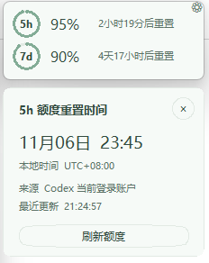
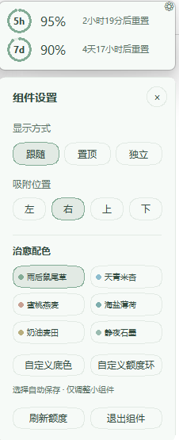

<div align="center">

# 余量 · Quiet Quota

**额度看一眼，安心继续写。🌿**

一个小小的 Windows 悬浮组件，陪 Codex 一起工作。

[开始使用](#-三步开始) · [看看界面](#-长这样) · [使用方法](#-看一眼就够了) · [问题反馈](https://github.com/pvhgfm5w4z-collab/quiet-quota/issues)


[](LICENSE)

</div>


不想再反复点开用量页面，也不想被低额度通知催促。把剩余比例与重置时间，安静地放在窗口旁边。

> **先说明白：** 当前读取的是 **Codex 额度**。组件可以跟随 ChatGPT 窗口，但不代表它读取了 ChatGPT 各模型的消息额度。

## 👀 长这样

### 额度与重置详情



### 配色与组件设置




### 两行，刚刚好

- 🟢 **5h / 7d 充电环**：看剩余，也看比例。
- 🕒 **重置倒计时**：不用自己算时间。
- 🪟 **窗口跟随**：移动、吸附、最小化联动。
- 🎨 **六套柔和配色**：也能自己选颜色。
- 🤫 **安静展示**：不弹低额度通知。


## 🚀 三步开始

### 方式一：让 GPT / Codex 帮你安装 💬

把下面这段话发给**有本机文件和终端操作能力的 Codex 或 GPT 助手**：

```text
请帮我在这台 Windows 电脑上安装 Quiet Quota（余量）：
https://github.com/pvhgfm5w4z-collab/quiet-quota

请先阅读仓库 README 和 install.py，确认安装操作，再检查 Python 3.11+、
Tkinter 和 Codex CLI 是否可用。将仓库下载到一个固定的用户目录，
不要使用临时目录，也不要覆盖已有文件或未提交修改；然后在仓库目录
运行 python install.py，并检查组件是否启动、插件是否安装成功。

安装会添加当前用户的登录启动快捷方式，让辅助程序后台等待
Codex / ChatGPT 窗口；我同意这个安装行为。
如果需要下载缺失的软件，请使用官方来源；登录和授权步骤请交给我操作。
不要索取、显示或复制我的令牌与认证文件，不要关闭安全保护。
完成后告诉我安装位置、如何打开设置，以及如何卸载。
```

> 普通网页聊天如果没有本机操作能力，只能提供指导，不能直接下载和安装。
> 需要登录 Codex 或授予系统权限时，仍需要你亲自完成。

### 方式二：自己安装 🧰

**① 准备环境**

Windows 10 / 11，安装 **Python 3.11+（包含 Tkinter）** 和 **Codex CLI**，并先完成 Codex 登录。无需第三方 Python 包。

**② 下载并安装**

```powershell
git clone https://github.com/pvhgfm5w4z-collab/quiet-quota.git
cd quiet-quota
python install.py
```

**③ 打开 Codex / ChatGPT**

组件在后台等待，找到目标窗口后显示。在新聊天中加载插件，或重启桌面端后，通过“打开余量设置”“查看我的 Codex 额度”控制它。

<details>
<summary>安装器具体做了什么？</summary>

- 生成适用于你电脑的插件路径配置。
- 登记本地插件源，并安装余量插件。
- 创建当前用户的登录启动快捷方式，让辅助程序静默等待窗口。
- 不修改 PowerShell 执行策略；不要求管理员权限；不修改 Codex / ChatGPT 本体。

这是**源码发行的早期版本**，目前没有预编译 EXE 和自动更新。请保留安装目录。

</details>

## 🫧 看一眼就够了

| 你想做什么 | 这样操作 |
| :--- | :--- |
| 看还剩多少 | 直接看 5h / 7d 环旁的百分比 |
| 看具体何时重置 | 点击对应行；再次点击收起 |
| 换颜色、换显示模式 | 点淡色齿轮，或右键组件 |
| 调整位置 | 拖动组件边缘，靠近主窗口边缘松手吸附 |
| 收起组件 | 跟随模式下，最小化主软件即可 |
| 退出 | 设置 → 退出组件 |

主软件最小化或关闭时，设置和详情浮层也会消失；恢复主窗口不会自动弹回设置。

### 三种显示方式

| 跟随窗口 · 默认 | 始终置顶 | 独立悬浮 |
| :--- | :--- | :--- |
| 随目标窗口移动、隐藏和恢复 | 保持在其他窗口上方 | 自由放置，不吸附跟随 |

### 六种配色，选一个舒服的 🌱

| 雨后鼠尾草 | 天青米杏 | 蜜桃燕麦 |
| :---: | :---: | :---: |
| 清淡绿，默认 | 天青与暖米色 | 柔和暖桃色 |
| **海盐薄荷** | **奶油麦田** | **静夜石墨** |
| 清爽青绿 | 温暖中性色 | 安静深色 |

颜色、位置和显示偏好会自动保存，也可以单独调整底色和额度环。

## 🔎 能看什么，不能看什么

| 数据 / 能力 | 状态 |
| :--- | :--- |
| Codex 5h / 7d 额度及重置时间 | ✅ 已接入，以账户实际返回为准 |
| 跟随 Codex / ChatGPT 桌面窗口 | ✅ 支持，两者显示同一份 Codex 数据 |
| ChatGPT 各模型消息额度 | — 未接入 |
| Claude Code / Cursor 等其他服务 | — 未接入 |
| 多账户、Token 与费用统计 | — 未实现 |

显示期间约 **每 60 秒**查询一次，恢复显示时也会请求刷新。倒计时在本地计算，不是逐秒向服务请求。

额度窗口缺失时显示“暂不可用”；读取失败保留上次数据并提示“未更新”。不会把读取失败当成 0%，也不会到重置时间就自行改成 100%。

## 🔐 数据留在哪里

- 通过本机 `codex app-server` 的 `account/rateLimits/read` 读取当前登录账户的 Codex 额度。
- 登录与认证由 Codex 处理，组件不复制登录凭据，不需要你粘贴 Token。
- 用户偏好、运行状态和错误记录保存在 `%LOCALAPPDATA%/QuietQuota`，不进入仓库。
- 插件与辅助程序用本地 stdio / 状态文件通信，不开放网络监听端口。
- 只查询额度，不发起模型任务；组件没有自建遥测或统计上报。

## 🛠️ 常见问题

<details>
<summary>读不到额度，或者只显示一项？</summary>

先确认终端能运行 `codex`，且已登录。账户可能没有返回某个窗口，缺失项不代表额度耗尽。可点击详情中的“刷新额度”重试。

</details>

<details>
<summary>安装后插件没有出现？</summary>

新建聊天或重启桌面端。插件和辅助程序是两部分，组件也能单独启动：

```powershell
pythonw plugin/scripts/widget.py
```

</details>

<details>
<summary>如何卸载？</summary>

```powershell
python install.py --uninstall
```

移除余量插件与 QuietQuota 登录启动快捷方式，并请求组件退出。用户偏好会保留在 `%LOCALAPPDATA%/QuietQuota`。

</details>

<details>
<summary>多显示器和缩放支持怎么样？</summary>

已有屏幕边界处理，但多显示器、不同 DPI 和窗口遮挡还需要更全面验证。遇到问题欢迎提供 Windows 版本、缩放比例与复现步骤。

</details>

## 🤝 一起让它更顺手

欢迎提交 [Issue](https://github.com/pvhgfm5w4z-collab/quiet-quota/issues) 或 Pull Request。截图与日志请先移除账户信息；不要上传认证文件、令牌或运行状态。

<details>
<summary>开发目录</summary>

```text
install.py                         安装与卸载
plugin/.codex-plugin/plugin.json    插件元数据
plugin/scripts/widget.py           界面与窗口跟随
plugin/scripts/limits.py            额度读取
plugin/scripts/server.py            本地 MCP 控制入口
plugin/skills/quiet-quota/          插件操作说明
docs/images/                       截图与原创表情图
```

</details>

## 致谢与许可

文档组织参考 [nanvon/cc-bar](https://github.com/nanvon/cc-bar)。本项目是独立 Windows 轻量组件，不是 cc-bar 的移植版，未导入其实现代码或视觉资产。

[MIT License](LICENSE) · Copyright © 2026 pvhgfm5w4z-collab。

<sub>非 OpenAI 官方项目。OpenAI、ChatGPT 与 Codex 等名称属于各自权利人。</sub>
